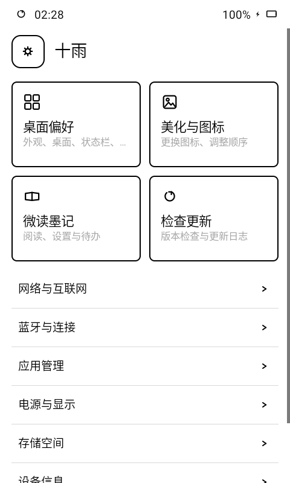
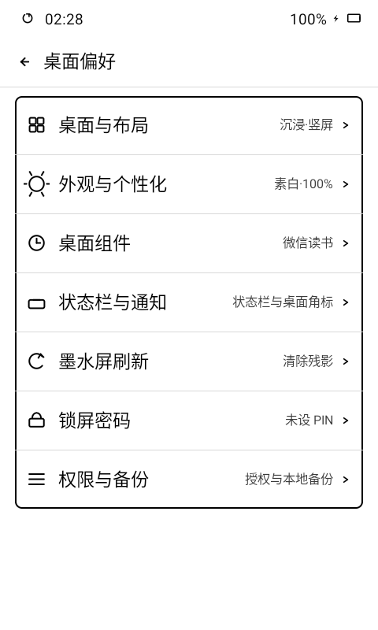
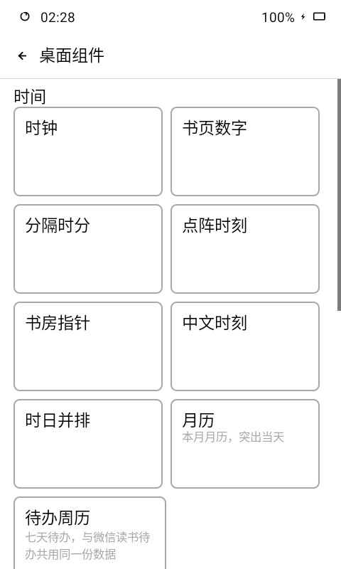

<div align="center">


# 十雨桌面

为 Android 墨水屏设备设计的阅读桌面。

把时钟、书架、阅读记录和待办放在每天打开的那一页。

[下载最新版](https://github.com/Mosley-Z/OctoberLauncher/releases/latest) · [查看更新](CHANGELOG.md) · [反馈问题](https://github.com/Mosley-Z/OctoberLauncher/issues)

</div>

## 从桌面开始阅读

十雨既是可以替换系统主屏幕的 Launcher，也是一个把阅读信息放在眼前的桌面。你可以保留熟悉的应用宫格，也可以切换到以书籍封面、时间和阅读统计为中心的沉浸模式；无需每次进入阅读应用，就能查看自己的进度和记录。

- **两种桌面，横竖都能用：** 普通模式适合应用与组件并用，沉浸模式突出正在读的书；支持宫格、列表和多页应用。
- **阅读数据成为组件：** 微信读书提供本周、本月、本书、本记、待办五种形态，按自己的习惯选择。
- **每一页可以不同：** 不同桌面页独立选择组件，时钟、月历、图片和阅读卡片可以分别安排。
- **为墨水屏日常使用准备：** 黑白界面、自绘时间与电量、手动整刷、刷新设置，以及 S4、P4 的布局适配。
- **本地内容也能读：** 内置文件浏览、图片编辑和多格式阅读预览，文件与阅读记录有各自入口。

## S4 实机界面

以下图片直接截取自 S4 上已安装的十雨桌面（480 × 800），保留当时使用的壁纸、图标、书籍与布局；未使用演示安装、示例数据或界面合成。截图中的装饰壁纸和应用图标是设备当前的个性化配置，不代表新安装后的默认外观。

| 沉浸阅读桌面 | 设置首页 |
| :---: | :---: |
|  |  |

| 桌面偏好 | 桌面组件库 |
| :---: | :---: |
|  |  |

## 功能详解

### 桌面与应用整理

普通模式把组件和应用放在同一屏，横屏时按可用空间分区；沉浸模式以大时间、封面轮播和阅读统计为中心，并保留应用入口。两种模式都支持横屏与竖屏。

- 应用可采用宫格或列表展示，支持翻页、调整顺序、隐藏与重新显示，以及更换图标。
- 首页和其他页可分别设置宫格容量，横屏、竖屏的行列也可单独保存，或选择自动适配。
- 每页组件独立保存；关闭某页组件后，释放出的空间交还应用区，后续应用向前补位。
- 长按桌面空白处进入桌面菜单；长按应用进行整理。沉浸模式也可以进入整理模式，无需放弃原有阅读布局。

### 微信读书：从进度到笔记

配置自己的微信读书授权信息后，十雨通过集成的微读墨记能力获取数据；桌面组件与书架共用缓存和刷新入口，不要求微信读书原应用始终运行。

| 组件形态 | 展示内容与用途 |
| --- | --- |
| **本周** | 按天查看本周阅读时长及周期统计，了解这一周的阅读节奏。 |
| **本月** | 查看当月阅读分布与统计，以月历热力图呈现日常积累。 |
| **本书** | 展示封面、书名、作者、阅读进度与累计时长；最近阅读的前十本支持双向循环轮播。 |
| **本记** | 把已选笔记放到桌面，可展开阅读、查看来源，并切换上一条或换一条；横屏展开时可借用右侧应用区阅读长文。 |
| **待办** | 查看与管理阅读相关待办，与独立待办周历共用一份清单。 |

沉浸桌面还显示今日阅读总量、读完书籍数和连续阅读天数。微读墨记入口保留阅读、设置与待办等操作；数据更新需要有效授权和可用网络，离线时可使用已有缓存。

### 负一屏「墨台」

从桌面向右滑动进入墨台，把书架与阅读资料集中在独立页面。它包含书架、最近图片、墨单、排行及阅读指纹等分区，可在墨台设置中调整显示与顺序。书架承接微信读书与本地阅读入口；最近图片可直接打开查看，阅读指纹提供选书与展示入口。

墨台与桌面组件各自承担不同用途：桌面用于随时看一眼，墨台用于集中浏览。涉及账号或内容的分区按已配置的数据源工作。

### 时钟、月历、待办和图片

- **时钟：** 除通用时钟外，组件库提供书页数字、分隔时分、点阵时刻、书房指针、中文时刻、时日并排六款固定钟面。通用时钟会根据组件高度采用常规或紧凑排布。
- **月历：** 展示本月日期并突出当天，适合把设备放在书桌上查看。
- **待办周历：** 按七天排列安排，与微信读书待办共用数据，避免分别维护两份清单。
- **图片：** 选择自己的图片作为组件，支持单张显示、多张按间隔轮播；图片来源及轮播状态按桌面页分别保存。

### 文件浏览与内置阅读

内置「文件」入口提供目录浏览、列表与缩略图宫格。可按名称、修改时间、大小或类型排序，切换升降序、显示隐藏文件，并管理自选文件夹。长按普通文件可查看详情或确认删除。

| 内容 | 支持能力 |
| --- | --- |
| TXT 与常见文本文件 | 内置文本阅读；可按文件情况选择编码。 |
| Markdown | 排版预览，也可按文本方式打开。 |
| EPUB | 内置电子书阅读，文件宫格可显示书籍封面。 |
| PDF | 内置页面预览，需 Android 8.1 及以上。 |
| 图片 | 图片查看，以及裁剪、旋转、灰度滤镜与对比度调整。 |
| DOCX | 文档预览。 |
| XLS、XLSX、CSV | 表格预览。 |
| PPTX | 演示文稿预览。 |
| ZIP | 浏览压缩包内容。 |
| APK | 先选择交给系统安装，或查看安装包结构。 |

阅读器资源随应用提供，本地文件预览不依赖在线文档转换服务。Office 以预览为主，复杂排版、大型表格或演示文稿可能受格式与设备内存限制；旧版 DOC、PPT 不在上述支持范围内。

### 外观、通知与设备设置

外观可调整壁纸、字体、图标包和应用图标，也可通过「美化与图标」整理应用。壁纸支持横屏方向设置；沉浸页面的空白区域直接透出壁纸。

自绘状态栏显示时间、电量和刷新入口；通知相关设置支持按应用折叠、合并同一会话、过滤系统汇总条目和桌面角标。通知读取需要通知使用权，具体系统面板行为取决于设备固件。

「墨水屏刷新」集中管理清除残影与整刷相关选项。S4、P4 有专门的布局适配；P4 可借助十雨无障碍服务，在隐藏真实状态栏时从顶部下滑展开系统通知，未连接服务时回退到真实系统栏。

### 配置备份与锁屏

- **备份与恢复：** 把桌面、外观、状态栏、锁屏等配置导出为 ZIP，并从文件恢复；恢复会覆盖当前配置，操作前会再次确认。它用于保存配置，不能代替对个人文档和阅读原文件的备份。
- **十雨锁屏：** 提供应用内 PIN 锁屏、手动锁定和独立锁屏壁纸；这是十雨自身的锁屏能力，系统级安全仍由 Android 提供。
- **应用更新：** 从设置首页检查新版本与更新日志。当前正式源为 GitHub Releases，国内更新源后续配置。

## 开始使用

1. 从 [Releases](https://github.com/Mosley-Z/OctoberLauncher/releases/latest) 下载 APK，按系统提示安装。
2. 打开十雨并完成首次引导；需要作为主屏幕时，设为默认桌面。
3. 在「设置 → 桌面偏好 → 桌面与布局」选择普通或沉浸模式、屏幕方向与应用布局。
4. 在「桌面组件」中选择组件，再按需调整外观；长按桌面空白处也可打开桌面操作菜单。
5. 需要阅读数据时，从「微读墨记」配置自己的授权信息；使用文件、通知或系统辅助功能时，再开启对应权限。

**从测试版迁移：** V1.0.0 使用新的长期正式签名，不能直接覆盖旧测试签名版本。请先在应用内导出备份，另行备份个人文件，再卸载测试版、安装正式版并恢复配置。后续正式版沿用同一签名，可覆盖升级。

## 设备与权限说明

最低 Android 8.0；当前主要在 Android 11 墨水屏设备上验证，并针对 S4、P4 适配。刷新效果、前光及系统栏表现会随固件不同；截图是系统直接捕获的画面，不呈现墨水屏的物理刷新过程。

权限按功能使用：文件访问用于本地内容；通知使用权用于通知与角标；无障碍服务用于需要系统辅助操作的功能。微信读书授权信息只应在自己的设备中配置，不要放进公开截图、问题反馈或配置分享。

---

## 开发与构建

### 环境

- JDK 17
- Android SDK 35、Build Tools 35.0.0
- Gradle 8.11.1（仓库已提供 Wrapper）

使用 Kotlin 和原生 Android View。`app` 负责组装，功能模块通过 `core` 中的公共契约协作。

```bash
git clone https://github.com/Mosley-Z/OctoberLauncher.git
cd OctoberLauncher

# 按本机环境设置 ANDROID_HOME 或创建 local.properties
./gradlew check :app:assembleDebug :app:assembleRelease
```

Windows 下使用 `gradlew.bat`。首次构建需要联网获取依赖。

| 目录 | 内容 |
| --- | --- |
| `app/` | 应用入口、宿主与模块装配 |
| `core/` | 配置、数据、设备适配、渲染及公共组件协议 |
| `feature/` | 桌面、组件、文件、阅读器和设置等功能 |
| `service/` | 通知监听与无障碍服务 |
| `libs/`、`tools/weread-kernel-host/` | 当前使用的微读内核及宿主补丁构建工具 |
| `config/` | Lint、detekt 等静态检查配置 |
| `release/` | 正式版说明与更新源约定 |

### 正式签名与发布

版本由 `VERSION` 和 `VERSION_CODE` 统一提供。没有生产密钥时，release 构建只生成未签名验证包；正式密钥不会进入仓库。

```powershell
$env:OCTOBER_SIGNING_PROPERTIES = 'C:/private/signing.properties'
# 使用本地打包脚本前，按 toolchain.path.example 配置工具链位置
pwsh -NoProfile -File scripts/package-release.ps1 -Offline
```

打包、签名校验、GitHub Release 附件及国内镜像格式见 [发布与更新源说明](release/README.md)。

### 来源与许可

项目集成微读墨记相关能力，并使用第三方文档预览组件。各组件的来源、许可和声明保留在对应目录与应用的“关于／开源许可”中；使用和分发时请遵守各自的许可要求。

阅读器资源的许可信息见 [文档预览组件](feature/reader/src/main/assets/reader/licenses/docx-assets.json)、[表格预览组件](feature/reader/src/main/assets/reader/web/sheets/LICENSES.txt)和[演示文稿预览组件](feature/reader/src/main/assets/reader/web/slides/LICENSES.txt)。
