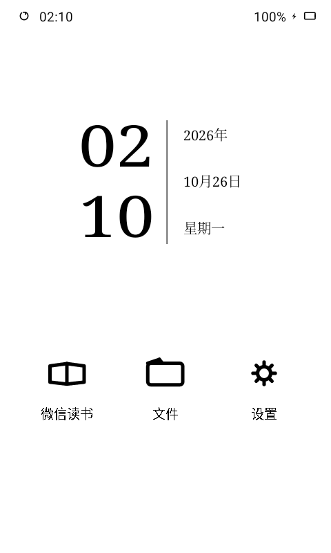
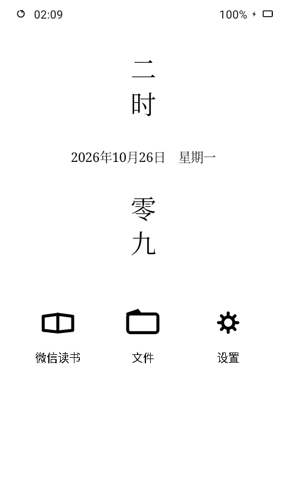
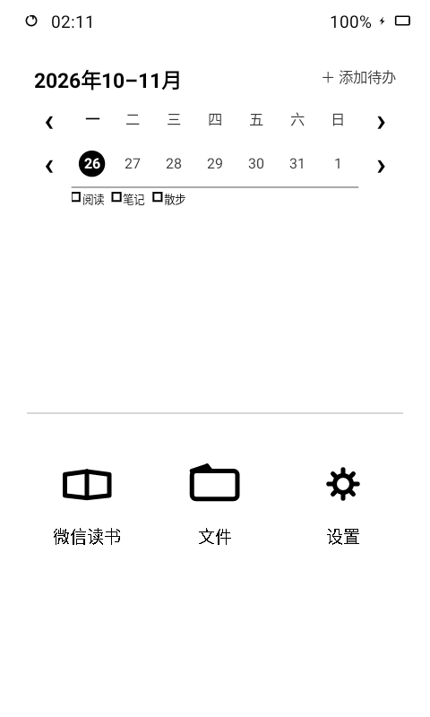

<div align="center">


# 十雨桌面

为 Android 墨水屏设备设计的阅读桌面。

把时钟、书架、阅读记录和待办放在每天打开的那一页。

[下载最新版](https://github.com/Mosley-Z/OctoberLauncher/releases/latest) · [查看更新](CHANGELOG.md) · [反馈问题](https://github.com/Mosley-Z/OctoberLauncher/issues)

</div>

## 能做什么

- **日常桌面，也可以是阅读桌面。** 普通与沉浸两种模式，支持横竖屏、宫格和列表、多页应用，以及每页独立选择组件。
- **把阅读进度放在眼前。** 连接自己的微信读书数据，查看书架、最近阅读、进度与时长，让本书和笔记成为桌面的一部分。
- **时钟不止一种样子。** 数字、中文、指针等多款钟面，配合日期与月历，适合把墨水屏留在书桌上。
- **待办直接看。** 用周历查看七天安排，和阅读页面共用待办清单。
- **文件打开就能读。** 内置文件管理、图片查看与编辑，支持 TXT、PDF、Markdown、EPUB、ZIP，以及常见 Office 文档预览。
- **保留自己的习惯。** 可调整壁纸、图标、布局与组件，并通过备份导出和恢复配置。

## 界面预览

以下为真实应用界面，使用独立演示安装和示例待办，不包含真实账号、书架或私人笔记。

| 时日并排 | 中文时刻 | 待办周历 |
| :---: | :---: | :---: |
|  |  |  |

## 开始使用

1. 从 [Releases](https://github.com/Mosley-Z/OctoberLauncher/releases/latest) 下载 APK，并按系统提示安装。
2. 打开十雨，完成首次引导；需要用作主屏幕时，将它设为默认桌面。
3. 长按桌面空白处或应用，选择组件、整理应用；在“设置”中调整布局和外观。
4. 如需阅读数据，在微读墨记相关设置中配置自己的授权信息；文件功能按需开启存储访问。

**从之前的测试版迁移：** V1.0.0 使用新的长期正式签名，不能直接覆盖旧测试签名版本。请先在应用内导出备份，再卸载测试版、安装正式版并导入备份。后续正式版本沿用同一签名，可覆盖升级。

## 设备与使用说明

- 最低 Android 8.0；当前主要在 Android 11 墨水屏设备上验证，并针对 S4、P4 做了适配。
- 支持横屏和竖屏；实际刷新、前光与系统栏行为会受设备固件影响。
- P4 如需隐藏真实状态栏并从自绘栏下拉系统通知，可启用十雨的系统无障碍服务。未启用时使用真实系统栏回退，基础桌面功能仍可使用。
- Office 文件以预览为主，复杂排版与较大文件受设备内存和预览能力限制。
- 当前从 GitHub Releases 检查更新；国内更新源将在后续接入。

---

## 开发与构建

### 环境

- JDK 17
- Android SDK 35、Build Tools 35.0.0
- Gradle 8.11.1（仓库已提供 Wrapper）

使用 Kotlin 和原生 Android View。`app` 负责组装，功能模块通过 `core` 中的公共契约协作。

```bash
git clone https://github.com/Mosley-Z/OctoberLauncher.git
cd OctoberLauncher

# 按本机环境设置 ANDROID_HOME 或创建 local.properties
./gradlew check :app:assembleDebug :app:assembleRelease
```

Windows 下使用 `gradlew.bat`。首次构建需要联网获取依赖。

| 目录 | 内容 |
| --- | --- |
| `app/` | 应用入口、宿主与模块装配 |
| `core/` | 配置、数据、设备适配、渲染及公共组件协议 |
| `feature/` | 桌面、组件、文件、阅读器和设置等功能 |
| `service/` | 通知监听与无障碍服务 |
| `libs/`、`tools/weread-kernel-host/` | 当前使用的微读内核及宿主补丁构建工具 |
| `config/` | Lint、detekt 等静态检查配置 |
| `release/` | 正式版说明与更新源约定 |

### 正式签名与发布

版本由 `VERSION` 和 `VERSION_CODE` 统一提供。没有生产密钥时，release 构建只生成未签名验证包；正式密钥不会进入仓库。

```powershell
$env:OCTOBER_SIGNING_PROPERTIES = 'C:/private/signing.properties'
# 使用本地打包脚本前，按 toolchain.path.example 配置工具链位置
pwsh -NoProfile -File scripts/package-release.ps1 -Offline
```

打包、签名校验、GitHub Release 附件及国内镜像格式见 [发布与更新源说明](release/README.md)。

### 来源与许可

项目集成微读墨记相关能力，并使用第三方文档预览组件。各组件的来源、许可和声明保留在对应目录与应用的“关于／开源许可”中；使用和分发时请遵守各自的许可要求。

阅读器资源的许可信息见 [文档预览组件](feature/reader/src/main/assets/reader/licenses/docx-assets.json)、[表格预览组件](feature/reader/src/main/assets/reader/web/sheets/LICENSES.txt)和[演示文稿预览组件](feature/reader/src/main/assets/reader/web/slides/LICENSES.txt)。
