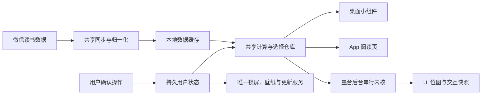

# 微读墨记功能审查与修复：技术总结与 DSH 交接

日期：2026-10-21。本文解释问题成因、最终设计和后续维护方式。各批次的具体构建、测试及双机结果以 `28`、`29`、`30`、`31` 号修复记录为准；详细工作方法见 [DSH 开发工作手册](33-dsh-development-playbook.md)。

## 一、产品边界与这次工作真正解决的问题

目标是让原微读墨记墨水屏用户继续使用熟悉的计算规则和操作方式，同时由十雨桌面独立获取微信读书数据。**用户已明确不需要导入原 App 数据，也不需要原 App 继续运行。** 第三批因此撤下了迁移入口及原 App 配置回写接线，把旧 `imported` 来源兼容为独立同步，保留既有本地缓存。

最初的主要缺陷不是页面数量不足，而是多个不完整的闭环：真实数据被近似值替代、设置只有写入没有消费者、桌面与 App 状态分裂、内存修改没有落盘、同名常量语义不一致，以及只在小数据量下看起来可用。

第一批的迁移修复记录是历史事实，不是今后产品要求。底层迁移实现和既有测试保留在源码中，但已不再向用户提供导入/回写入口；后续开发不要重新依赖它们来补齐官方同步流程。

## 二、审查项与解决方向

此表描述实现方向，不替代各批次的验收矩阵。

| 项目 | 问题 | 解决方向/所属批次 |
| --- | --- | --- |
| R01 | 阅读成就设置未进入桌面 | 第二批：桌面和 App 共用目标、剩余与达成文案，历史周期不显示当前目标。 |
| R02 | 本书进度、时长取错或猜测 | 第一批：逐书官方进度接口，未知与失败保留语义，不用榜单推累计。 |
| R03 | 自动/手选书行为不完整 | 第一、二批：最近阅读时间决定自动书目，手选共享持久化并补查真实进度。 |
| R04 | 划线来源书名和字段异常 | 第一批：按真实书目标识归一化书名、作者、章节与内容字段。 |
| R05 | 笔记库分页与想法不完整 | 第一批：完整索引、逐书划线和想法文件，失败续补。 |
| R06 | 本记抽样、访问历史和选书状态不一致 | 第二批：共享选择仓库，默认池与选书池分别保持正确顺序和计数。 |
| R07 | 刷新、绑定刷新只更新局部显示 | 第二批：按实际形态取数并补拉已启用绑定目标。 |
| R08 | 待办包含已完成项或点击错条目 | 第二批：绘制与命中使用同一过滤序列。 |
| R09 | 阅读资产从 Top 榜近似 | 第一批：逐书累计缓存、完整资产集合、失败保留。 |
| R10 | 墨台开关、顺序没有实际生效 | 第三批：共用模块策略，设置两入口统一掩码和顺序，全关不补默认项。 |
| R11 | 指纹字号、选书不持久且退化成单选 | 第三批：笔记索引候选、多选草稿、最多 50 本、明确清空与持久字号。 |
| R12 | 指纹导出传错分区 | 第三批：实际 k6 语义常量及原版纸张尺寸，核查真实保存结果。 |
| R13 | 人工价格与移出书目只在内存 | 第三批：确认前保存、清价标记、隐藏空快照、恢复及跨分区刷新。 |
| R14 | 原 App 导入路径不能可靠使用 | 第一批曾修复；第三批按最新需求撤下产品入口，改为独立同步。 |
| R15 | 实验室密码与实际锁屏服务分离 | 第四批：使用宿主唯一锁屏和壁纸仓库，设置、清除、自动与立即锁定共用状态。 |
| R16 | 桌面卡片池过滤了 App 导航 | 第四批：App 始终提供全部阅读形态和足迹，池只影响桌面。 |
| R17 | 循环/列表切换设置没有交互消费者 | 第二批：桌面按模式执行，并限制在启用池内。 |
| R18 | 更新通道与备用源没有实际消费者 | 第四批：移除失效选项，明确内置功能随宿主更新，统一进入十雨更新服务。 |

远程翻页属于原审查单独列出的实验版本范围，不与 18 项确定问题混算。用户最终明确要求直接移除：第四批删除翻页页面与页签，不保留占位模块，实验室只保留锁屏与续航优化。

## 三、最终的数据与状态分工

数据缓存与用户状态的写入责任分开。联网刷新更新缓存，用户确认更新持久状态；展示与执行读取各自的共享消费者。

### 1. 数据获取

`core/weread-sync` 负责同步规则，宿主与内容层共用适配，不应再写第二套临时解析：

- `WereadBookSync`：书架、最近在读、逐书进度、累计资产缓存。
- `WereadNoteSync`：笔记索引、逐书划线、个人想法和分页。
- `WereadCardRefreshService`：当前形态刷新及绑定目标集合。
- `WereadSyncService`：完整同步与部分成功状态。
- `WereadDataGate`：避免互相冲突的同步写入。

本地的 `shelf.json`、进度缓存、`nt_index.json`、`nt_<id>.json`、`ni_<id>.json` 是官方数据的缓存与归一化结果，不意味着必须来自原 App。接口失败不能清空已有有效数据，也不能把请求时刻写成成功刷新时刻。

### 2. 用户状态

| 状态 | 权威位置 | 消费者 |
| --- | --- | --- |
| 自动/手动本书 | `WereadBookSelection` | 桌面与阅读页 |
| 本记选书、当日选择与历史 | `WereadNoteSelection` / `note_selection.json` | 桌面与阅读页 |
| 阅读成就规则 | `WereadAchievement` | 桌面与阅读页 |
| 墨台模块及顺序 | `DeskModulePolicy` + `LauncherConfig` | 墨台与外部负一屏设置 |
| 指纹选书、字号 | `integrations.wereadDesk` | 指纹选书、分区与导出 |
| 手填价格 | `kernel_prefs.string[menu_prices.<bookId>]` | 内核账单与资产 |
| 移出书目 | `kernel_prefs.string[menu_hidden.ids]` | 资产、隐藏计数与恢复 |
| 锁屏密码及自动锁定 | `LauncherConfig.lock` / `LockGateImpl` | 实验室、宿主设置和实际覆盖层 |
| 锁屏背景 | `appearance.lockWallpaperPath` / 壁纸仓库 | 实际锁屏背景 |
| 更新地址 | `integrations.updateUrl` | 宿主更新服务 |

选择状态由用户操作决定，同步不能重新选择或重置。原版规则需要保留的细节，例如当日稳定抽样、手选书顺序、清空后不复活、未完成待办过滤，都应放在共享层，不能靠两个页面各写一遍来“保持一致”。

### 3. 展示和执行

页面应读取共享状态并发出用户意图。真正的密码校验属于锁屏服务，背景解码和替换属于壁纸仓库，更新属于宿主更新服务。复用这些消费者，比给实验室再造一套偏好和执行链更容易证明正确。

## 四、几个关键问题的因果链

### 1. 进度和资产为什么会错

把可获得的榜单或书架字段当作所需字段，能快速填满 UI，却改变了统计含义。周期时长不等于累计时长，列表位置不等于最近阅读，未知进度不等于未开始。

修复时先核对官方字段，再统一归一化和缓存。共享逐书接口结果，避免书架与资产各自重复请求。最近在读每轮补查，未变化历史书按有效期复用缓存；传输失败保留旧值并停止无意义的后续请求。

### 2. 设置为什么会“保存了但没用”

原实现常在页面写一个键，真正执行服务读取另一处。修复必须同时找写入方和读取方；搜到写入键只是起点。锁屏、更新、模块开关、字号和切换模式都需要这项检查。

锁屏的链路还必须追到可见覆盖层。真机曾出现“立即锁定已经把服务状态设为 true，但页面没有上锁”：宿主 Activity 只在恢复时检查状态，没有订阅锁状态变化。最终补齐服务观察器的注册、主线程界面同步与销毁时撤下，再验证立即锁定和自动锁定。调用了正确服务，仍不等于完成了显示闭环。

整数尤其不能凭名字复用：十雨指纹配置位与内核位不同，导出分区 2 与 3 也不同。用语义常量和显式适配，让配置、布局与导出各自的类型边界清楚。

### 3. 为什么重进或同步后人工编辑消失

内核的 `setPrice` 和隐藏集合原本只修改当前页面内存；重建会重新读取磁盘。只调用 `invalidate` 无法补上持久化。

现在录价在确认前保存，成功后让内核使用同一值，并刷新其他分区。清价不是简单删除新键：需要明确记录删除，阻止旧文件回流。隐藏恢复同理，空快照是有效状态。确认与取消的边界需要独立测试。

### 4. 为什么“后台加载”仍然会 ANR

第一次修复把巨型偏好文件的逐书重复解析改为缓存，首载得到改善，但录价面板的 `drawDirect` 仍在主线程调用完整内核渲染，重算资产。也就是说，启动阶段在后台不代表所有交互都在后台。

后续处理必须覆盖绑定、测量、渲染、长按与编辑的完整调用链，避免线程之间同时修改同一个内核页面。对于低功耗设备，应该通过串行后台计算与结果缓存控制工作量，并使旧页面任务失效。用大书库和实际长按复验，才能识别这类缺陷。

### 5. 为什么选书弹框也要核对原版来源

实际 k6 候选接口会混入整个书架；原版选书来源是笔记索引。把未读且无笔记的书列为候选，用户能确认但不能生成有效指纹。这次恢复为笔记索引口径，并标注未同步正文的条目。

“数据条数很多”不是完整性的证明。首先要问这些条目是否属于这个功能所需集合。

## 五、批次组织与证据等级

采用四批而不是一次大改，是为了先修可信数据，再恢复共享行为，再收敛墨台，最后接通宿主服务。每批保留可构建状态，但当真机发现新问题时继续修复，不能以“代码已经通过测试”结束。

本次交接将证据分成三层：

1. **源码与依赖核对**：确认规则、真实接口、读写消费者和实际 jar 行为。
2. **自动化验证**：验证真实形状样本、状态转换、失败保留、并发互斥和缓存失效。
3. **真机验证**：操作命中、慢拖、长按、刷新、重启、实际 PNG、PIN 和双屏布局。

三者互相补充。测试通过不能代替双机操作，截图也不能证明请求、保存或执行服务实际运行。各批次报告应分别记录覆盖范围，避免把源码实现、自动测试通过和真机通过合并成一个“已完成”。

## 六、交给 DSH 的维护重点

### 修改前

- 先读用户最新目标以及工作区 diff，尊重已有并行修改。
- 从用户任务找到原版规则、实际内核契约和状态消费者。
- 判断变化应放共享层、页面层还是宿主执行层，避免在页面复制业务逻辑。

### 修改时

- 每份用户状态只保留一个权威来源；只让同步维护它拥有的联网数据。
- 对大书库先估算 IO 与解析次数，避免主线程全库操作。
- 对空、未知、免费、删除、未配置和取消分别表达语义。
- 明确后台任务生命周期，避免过期回调覆盖新页面。
- 保持文件所有权与设备 serial 所有权清楚，构建和集成统一执行。

### 交付前

- 格式化与检查分开跑，新增告警修到通过，不修改基线绕过。
- 用最终同一安装包完成 P4/S4 矩阵；测试后合并恢复原用户状态。
- 检查实际导出内容、保存文件尺寸、重启后的状态和执行服务。
- 报告最终行为、证据、限制、版本与是否提交/发布。

更具体的命令、排查路径、用例模板和检查表见 [工作手册](33-dsh-development-playbook.md)。建议 DSH 每次接手先阅读本总结，再从手册的简表建立本次任务的验收清单。
